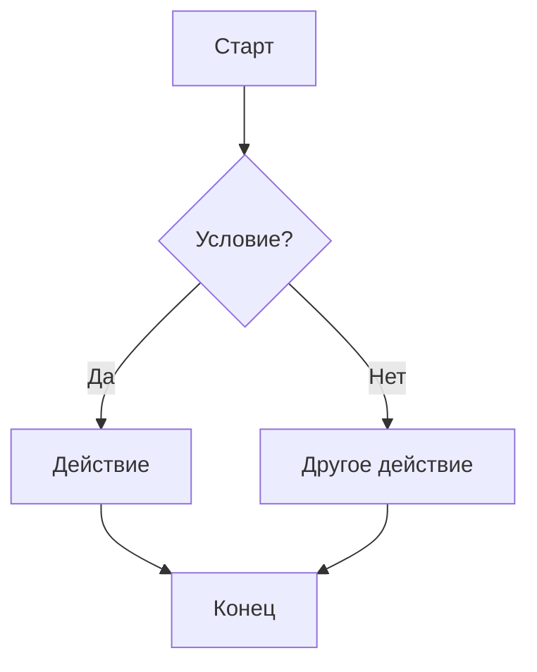
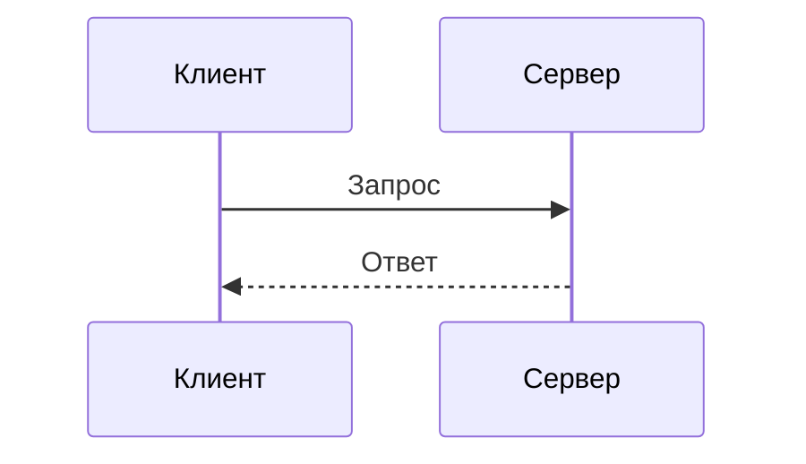
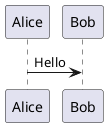

# Тест Markdown: все конструкции

> Файл для проверки ридера. Разделы идут от базового CommonMark к расширениям
> GFM и к редким расширениям (Pandoc, MultiMarkdown, Obsidian и т. д.).
> Front matter выше (YAML между `---`) тоже часть теста.

[TOC]

---

## 1. Заголовки

# H1 — заголовок первого уровня
## H2 — заголовок второго уровня
### H3 — заголовок третьего уровня
#### H4 — заголовок четвёртого уровня
##### H5 — заголовок пятого уровня
###### H6 — заголовок шестого уровня

####### Семь решёток — это НЕ заголовок, а обычный текст

#Без пробела — тоже не заголовок (в CommonMark)

### Заголовок с закрывающими решётками ###

### Заголовок с *курсивом*, **жирным** и `кодом`

### Заголовок со своим id {#custom-id}

Setext-заголовок первого уровня
===============================

Setext-заголовок второго уровня
-------------------------------

## 2. Абзацы и переносы строк

Это обычный абзац. Строки внутри одного абзаца
склеиваются в одну, если между ними нет пустой строки.

Это новый абзац после пустой строки.

Жёсткий перенос через два пробела в конце строки  
вот эта строка должна начаться с новой строки.

Жёсткий перенос через обратный слэш\
и эта строка тоже с новой строки.

Перенос через HTML<br>тег br.

Очень длинная строка без переносов для проверки переноса по ширине окна: Lorem ipsum dolor sit amet, consectetur adipiscing elit, sed do eiusmod tempor incididunt ut labore et dolore magna aliqua. Ut enim ad minim veniam, quis nostrud exercitation ullamco laboris nisi ut aliquip ex ea commodo consequat. Duis aute irure dolor in reprehenderit in voluptate velit esse cillum dolore eu fugiat nulla pariatur.

ОченьДлинноеСловоБезПробеловКотороеДолжноКорректноПереноситьсяИлиХотяБыНеЛоматьВёрсткуДокументаВообщеНикакимОбразомАааааааааааааааааааааа

## 3. Выделение текста

*курсив звёздочками* и _курсив подчёркиваниями_

**жирный звёздочками** и __жирный подчёркиваниями__

***жирный курсив*** и ___жирный курсив___ и **_смешанный_** и *__смешанный__*

~~зачёркнутый (GFM)~~ и ~одинарная тильда~

**Жирный с *вложенным курсивом* внутри**

*Курсив с **вложенным жирным** внутри*

Внутри слова: пре*фикс*ный, пре**фикс**ный, snake_case_variable (подчёркивания внутри слова не должны давать курсив).

Звёздочки без пары: 2 * 3 * 4 = 24, а также * одинокая звёздочка.

==выделение маркером== (расширение)

H~2~O — нижний индекс, x^2^ — верхний индекс (расширения)

<u>подчёркнутый HTML</u>, <mark>mark HTML</mark>, <sub>sub</sub> и <sup>sup</sup>, <kbd>Ctrl</kbd>+<kbd>Shift</kbd>+<kbd>A</kbd>

++вставленный текст++ (расширение markdown-it-ins)

## 4. Цитаты

> Простая цитата.

> Многострочная цитата,
> которая продолжается на следующей строке.
>
> И второй абзац в той же цитате.

> Ленивое продолжение цитаты:
эта строка без `>`, но всё равно в цитате.

> Уровень 1
>> Уровень 2
>>> Уровень 3
>>>> Уровень 4

> ### Заголовок в цитате
>
> - список в цитате
> - второй пункт
>
> ```python
> print("код в цитате")
> ```
>
> **Жирный** и `код` в цитате.

## 5. Списки

### 5.1 Маркированные

- пункт с дефисом
- второй пункт
- третий пункт

* пункт со звёздочкой
* второй

+ пункт с плюсом
+ второй

### 5.2 Нумерованные

1. первый
2. второй
3. третий

1. все единицы
1. должны стать
1. 1, 2, 3

7. список начинается с семи
8. восемь
9. девять

1) нумерация со скобкой
2) второй пункт

### 5.3 Вложенные

- Уровень 1
  - Уровень 2
    - Уровень 3
      - Уровень 4
        - Уровень 5
- Снова уровень 1
  1. Нумерованный внутри маркированного
  2. Второй
     - И маркированный внутри нумерованного
1. Нумерованный верхнего уровня
   - вложенный
   - ещё

### 5.4 «Рыхлый» список (с абзацами)

- Первый пункт с абзацем.

  Второй абзац того же пункта.

- Второй пункт.

  ```bash
  echo "код внутри пункта списка"
  ```

- Третий пункт с цитатой:

  > цитата внутри пункта

### 5.5 Списки задач (GFM)

- [x] выполненная задача
- [ ] невыполненная задача
- [X] выполненная с большой X
- [ ] задача с **форматированием** и [ссылкой](https://example.com)
  - [x] вложенная выполненная
  - [ ] вложенная невыполненная

1. [ ] задача в нумерованном списке
2. [x] вторая

### 5.6 Граничные случаи

-не список (нет пробела)

2026\. Это не список, точка экранирована.

- 
  пустой первый пункт со следующей строкой

- a
- b

- c (новый список после пустой строки? зависит от парсера)

## 6. Код

Встроенный код: `printf("hi")`, с обратной кавычкой внутри: `` a ` b ``, с пробелами по краям: `` `код` ``.

Блок с отступом в 4 пробела:

    int main() {
        return 0;
    }

Огороженный блок без языка:

```
просто текст
  с отступами    и   пробелами
```

Огороженный тильдами:

~~~
код в тильдах
~~~

Блок с ``` внутри (внешний из четырёх кавычек):

````markdown
```js
console.log("вложенный блок");
```
````

### 6.1 Подсветка синтаксиса

```c
#include <stdio.h>

int main(void) {
    printf("Hello, %s!\n", "world");
    return 0;
}
```

```cpp
#include <cstdint>
#include <iostream>
#include <vector>

int main() {
    std::vector<std::int64_t> v{1, 2, 3};
    for (auto x : v) std::cout << x << '\n';
}
```

```python
from dataclasses import dataclass

@dataclass
class Point:
    x: float
    y: float

    def norm(self) -> float:
        return (self.x ** 2 + self.y ** 2) ** 0.5

print(f"{Point(3, 4).norm()=}")
```

```javascript
const sum = (...xs) => xs.reduce((a, b) => a + b, 0);
console.log(`sum = ${sum(1, 2, 3)}`);
```

```typescript
interface User { id: number; name: string }
const greet = (u: User): string => `Hi, ${u.name}`;
```

```rust
fn main() {
    let v: Vec<i32> = (1..=5).collect();
    println!("{:?}", v);
}
```

```go
package main

import "fmt"

func main() { fmt.Println("hello") }
```

```bash
#!/usr/bin/env bash
for f in *.md; do
  echo "Файл: $f"
done
```

```json
{
  "name": "test",
  "version": 1,
  "nested": { "array": [1, 2, 3], "null": null, "bool": true }
}
```

```yaml
server:
  host: 127.0.0.1
  ports: [80, 443]
```

```toml
[package]
name = "demo"
version = "0.1.0"
```

```html
<!DOCTYPE html>
<html>
  <body><h1 class="title">Привет</h1></body>
</html>
```

```css
body { margin: 0; font-family: sans-serif; }
.title:hover { color: #b8bb26; }
```

```sql
SELECT id, name FROM users WHERE age > 18 ORDER BY name;
```

```lua
local t = { a = 1, b = 2 }
for k, v in pairs(t) do print(k, v) end
```

```diff
- удалённая строка
+ добавленная строка
  неизменённая строка
```

```неизвестный-язык
блок с несуществующим языком — не должен падать
```

```python title="example.py" {2,3}
# блок с атрибутами в info string
a = 1
b = 2
```

## 7. Горизонтальные линии

---

***

___

- - -

* * *

## 8. Ссылки

[Обычная ссылка](https://example.com)

[Ссылка с title](https://example.com "Подсказка при наведении")

[Относительная ссылка](./other-file.md)

[Якорь на раздел «Таблицы»](#9-таблицы)

[Якорь на custom-id](#custom-id)

[Ссылка-сноска][ref1], [ещё одна][REF1] (регистр не важен), [короткая форма][] и [ref2].

[ref1]: https://example.com/ref1 "Заголовок ref1"
[короткая форма]: https://example.com/short
[ref2]: <https://example.com/с пробелами> 'В одинарных кавычках'

Автоссылка: <https://example.com>, почта: <user@example.com>

Голый URL (GFM autolink): https://example.com/path?a=1&b=2#frag и www.example.com

Ссылка с **жирным** текстом: [**жирная ссылка**](https://example.com), с кодом: [`code`](https://example.com)

Ссылка со скобками в URL: [Википедия](https://ru.wikipedia.org/wiki/Markdown_(язык))

Кириллический URL: [пример](https://пример.рф/путь)

Пустая ссылка: [](https://example.com) и ссылка без адреса: [текст]()

Вики-ссылки (Obsidian): [[Другая заметка]] и [[Заметка|с псевдонимом]]

## 9. Таблицы

| Слева | По центру | Справа | Без выравнивания |
|:------|:---------:|-------:|------------------|
| a     | b         | c      | d                |
| длинная ячейка с текстом | `код` | **жирный** | *курсив* |
| 1 | 2 | 3 | 4 |
| [ссылка](https://example.com) | ~~зачёркнуто~~ | 100.00 | |

Таблица без боковых вертикальных черт:

Имя | Значение
--- | ---
x | 1
y | 2

Экранированная черта внутри ячейки:

| Выражение | Значение |
|-----------|----------|
| `a \| b`  | или      |
| a \| b    | тоже или |

Таблица с неровным числом ячеек:

| A | B | C |
|---|---|---|
| 1 | 2 |
| 1 | 2 | 3 | 4 |

Очень широкая таблица:

| Кол 1 | Кол 2 | Кол 3 | Кол 4 | Кол 5 | Кол 6 | Кол 7 | Кол 8 | Кол 9 | Кол 10 | Кол 11 | Кол 12 |
|---|---|---|---|---|---|---|---|---|---|---|---|
| значение | значение | значение | значение | значение | значение | значение | значение | значение | значение | значение | значение |

## 10. Изображения


![Картинка по ссылке-сноске][img-ref]

[img-ref]: https://picsum.photos/200/100

[](https://example.com)


## 11. HTML

<div align="center">
  <b>Блок HTML</b> по центру
</div>

<details>
<summary>Раскрывающийся блок (нажми)</summary>

Скрытое содержимое с **markdown** внутри.

```js
console.log("код внутри details");
```

</details>

<table>
  <tr><th>HTML</th><th>таблица</th></tr>
  <tr><td>1</td><td>2</td></tr>
</table>

<!-- Это HTML-комментарий, его не должно быть видно -->

<p style="color: red">Абзац с инлайн-стилем</p>

<dl>
  <dt>HTML-термин</dt>
  <dd>HTML-определение</dd>
</dl>

<script>alert("Если это выполнилось — ридер небезопасен (XSS)!")</script>


[XSS-ссылка](javascript:alert('xss'))

<iframe src="https://example.com" width="300" height="100"></iframe>

## 12. Экранирование и спецсимволы

\*не курсив\*, \_не курсив\_, \`не код\`, \# не заголовок, \[не ссылка\](url)

\\ обратный слэш, \> не цитата, \- не список, \+ \! \{ \} \( \) \. \| \~

HTML-сущности: &copy; &reg; &trade; &amp; &lt; &gt; &quot; &nbsp; &mdash; &ndash; &hellip; &#8364; &#x1F600;

Сырые символы: < > & " ' — должны отображаться как есть: a < b && c > d

Типографика: "прямые кавычки", 'одинарные', -- двойной дефис, --- тройной, ... многоточие, (c) (r) (tm) +-

Неразрывный пробел и табуляция:    ←таб→    (внутри текста)

## 13. Сноски

Текст со сноской[^1] и ещё одной[^note]. Повторное использование сноски[^1].

Встроенная сноска^[Это inline-сноска (Pandoc).].

[^1]: Текст первой сноски.
[^note]: Многоабзацная сноска.

    Второй абзац сноски с отступом.

    ```
    код в сноске
    ```

## 14. Списки определений (расширение)

Термин 1
: Определение первого термина.

Термин 2
: Первое определение второго термина.
: Второе определение второго термина.

## 15. Аббревиатуры (расширение)

HTML и CSS используются в вебе.

*[HTML]: HyperText Markup Language
*[CSS]: Cascading Style Sheets

## 16. Предупреждения / Callouts

GitHub alerts:

> [!NOTE]
> Полезная информация.

> [!TIP]
> Совет.

> [!IMPORTANT]
> Важно.

> [!WARNING]
> Предупреждение.

> [!CAUTION]
> Осторожно.

Obsidian callout со сворачиванием:

> [!info]- Свёрнутый callout с заголовком
> Содержимое скрыто по умолчанию.

MkDocs / Python-Markdown admonition:

!!! note "Заголовок заметки"
    Текст внутри admonition.

Container (markdown-it-container / VuePress):

::: warning
Контейнер-предупреждение
:::

## 17. Математика (LaTeX)

Встроенная формула: $E = mc^2$, и ещё $\sum_{i=1}^{n} i = \frac{n(n+1)}{2}$.

Блочная формула:

$$
\int_{-\infty}^{+\infty} e^{-x^2}\,dx = \sqrt{\pi}
$$

$$
\begin{pmatrix} a & b \\ c & d \end{pmatrix}
\begin{pmatrix} x \\ y \end{pmatrix}
=
\begin{pmatrix} ax + by \\ cx + dy \end{pmatrix}
$$

GitHub-стиль: $`\alpha + \beta`$

```math
f(x) = \begin{cases} x^2, & x \ge 0 \\ -x, & x < 0 \end{cases}
```

Доллар не как формула: цена $5 и $10.

## 18. Диаграммы







## 19. Эмодзи и Unicode

Шорткоды: :smile: :rocket: :+1: :warning: :heart:

Напрямую: 😀 🚀 👍 ⚠️ ❤️ 🇷🇺 👨‍👩‍👧‍👦 (составной эмодзи)

Разные письменности: English, Русский, Ελληνικά, 中文, 日本語, 한국어, עברית, العربية, हिन्दी

RTL-текст: مرحبا بالعالم — שלום עולם

Комбинирующие символы: é (e + ́), Z̤͔ͧ̑̓ä͖̭̈̇lͮ̒ͫǧ̗͚̚o̙̔ͮ̇͐̇

Математические символы: ∀x ∈ ℝ, ∃y: x² + y² ≤ r², ∞, ≠, ≈, √, ∑, ∫

Псевдографика:

```
┌─────┬─────┐
│  A  │  B  │
├─────┼─────┤
│  1  │  2  │
└─────┴─────┘
```

## 20. Прочие расширения

Теги (Obsidian): #тег #вложенный/тег

Встраивание (Obsidian): ![[Другая заметка]]

Комментарий Obsidian: %%этого не должно быть видно%%

Атрибуты (kramdown/markdown-it-attrs): **жирный**{.class #id style="color:blue"}

Упоминания и ссылки GitHub: @username, #123, user/repo#456, коммит a1b2c3d

Клавиши: <kbd>Super</kbd> + <kbd>K</kbd>

Строка с [ ] квадратными скобками, но не ссылка, и [x] не задача вне списка.

## 21. Вложенность «всё во всём»

1. Пункт списка
   > Цитата в пункте
   > 
   > | Таблица | в цитате |
   > |---------|----------|
   > | 1       | 2        |
   >
   > - [x] задача в цитате в списке
   >   ```python
   >   print("код в задаче в цитате в списке")
   >   ```

2. Второй пункт с формулой $a^2+b^2=c^2$ и сноской[^1].

> - список
>   > вложенная цитата в списке в цитате
>   > 1. нумерованный ещё глубже
>   >    - и ещё глубже: `код`, **жирный**, [ссылка](#)

## 22. Граничные случаи парсинга

Пустой блок кода:

```
```

Незакрытый `инлайн-код

Незакрытое **жирное выделение

Незакрытая [ссылка(https://example.com)

Абзац сразу после списка:
- пункт
Текст, который может «прилипнуть» к пункту (ленивое продолжение).

Строка из одних пробелов ниже:
   
Конец пробельной строки.

   Абзац с 3 пробелами отступа (ещё не код)

    Строка с табуляцией (должна стать кодом)

<!-- многострочный
HTML-комментарий
-->

Последняя строка файла без перевода строки в конце.